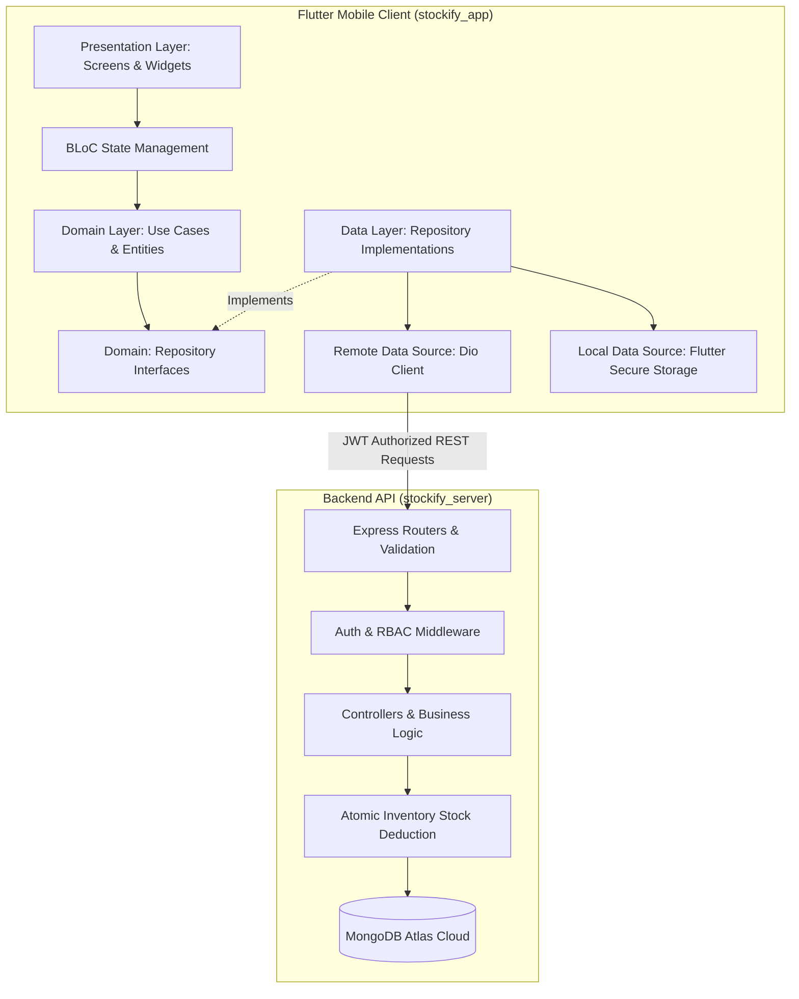
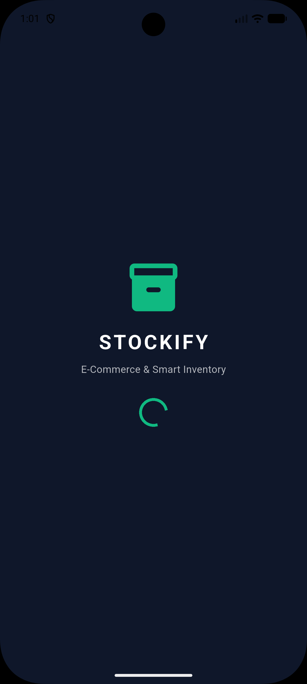
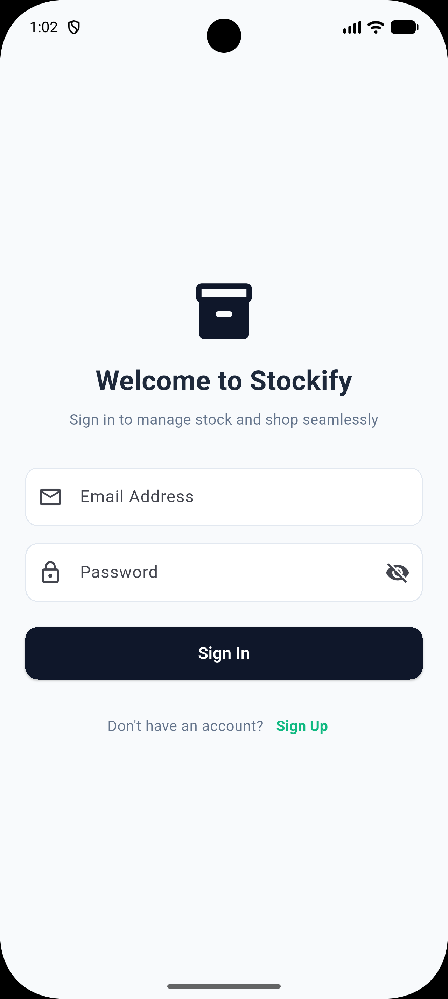
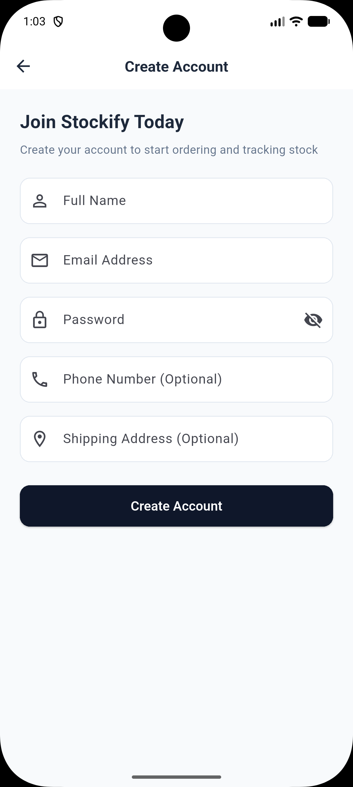
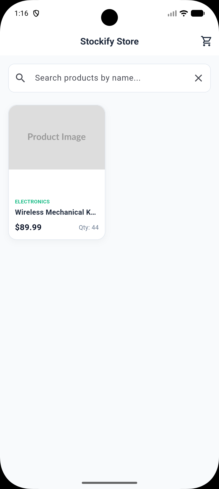
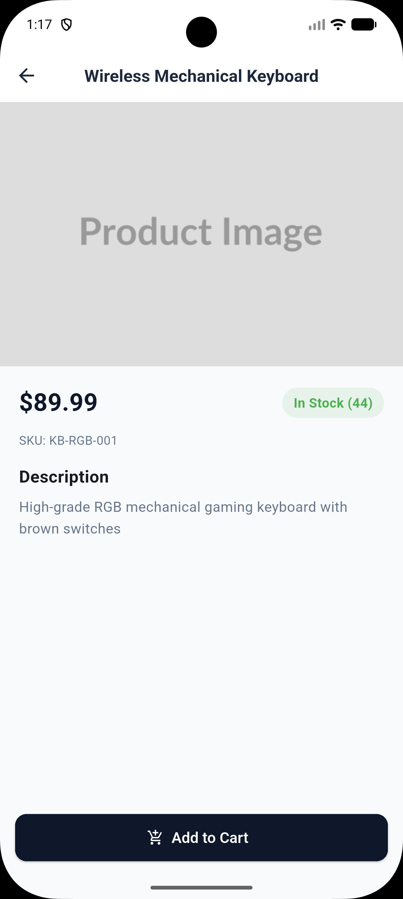
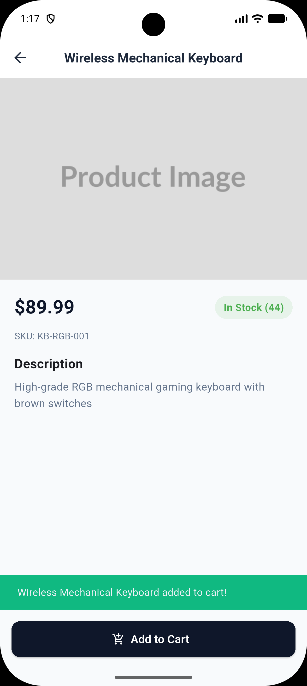
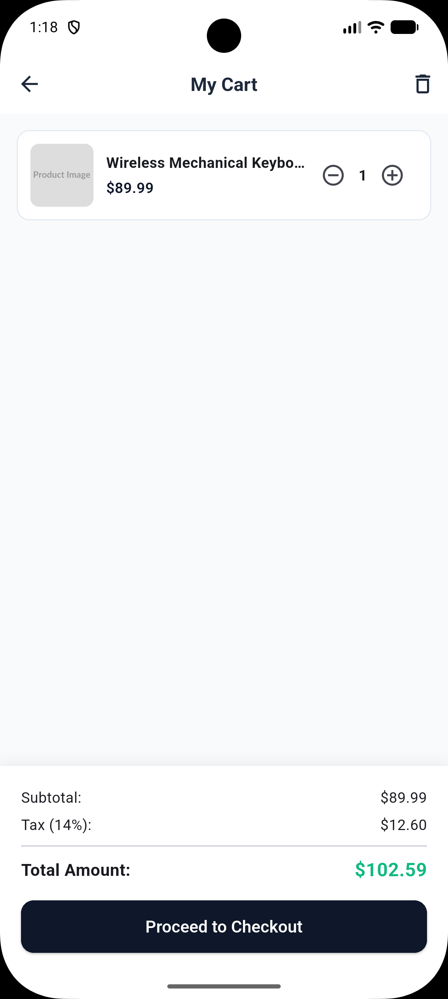
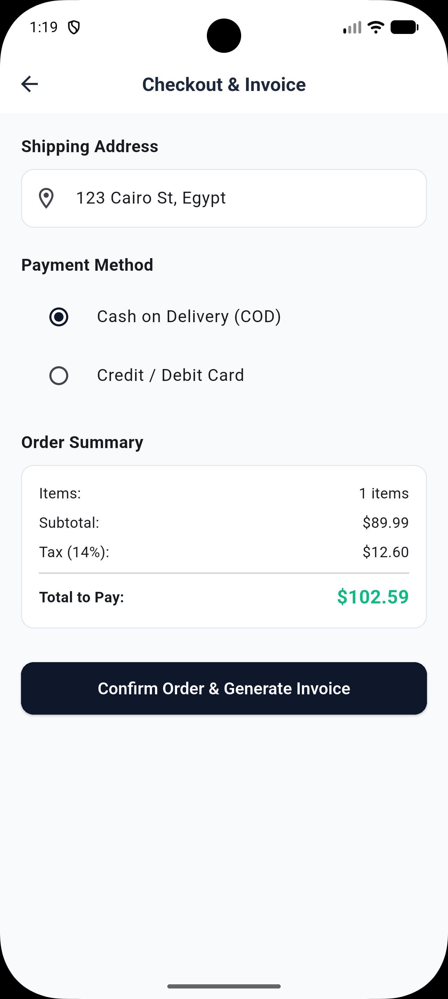
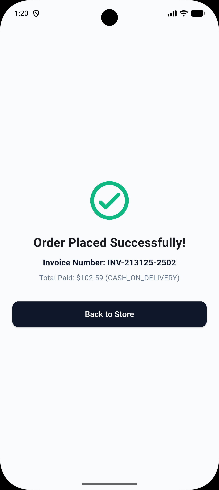

# 📦 Stockify - Enterprise E-Commerce & Smart Inventory System

<p align="center">
  
  
  
  
  
  
  
</p>

**Stockify** is a production-ready, full-stack enterprise mobile and backend application that bridges the gap between customer-facing **E-Commerce storefronts** and **real-time Inventory Management (ERP/Invoicing)**. 

Unlike conventional mock shops, Stockify enforces strict **backend business logic**: every checkout generates a legally-structured tax invoice and atomically deducts physical warehouse stock with race-condition prevention.

---

## 🏗️ Architecture & Engineering Design

The project is structured as a unified **Monorepo** following **Uncle Bob's Clean Architecture** principles and **Feature-First modularization** in Flutter, coupled with a **Layered Controller-Service Architecture** in Node.js.



---

## 📱 Mobile Application Architecture (`stockify_app`)

- **Domain Layer (Pure Dart)**: Zero dependencies on external packages. Contains business entities (`ProductEntity`, `UserEntity`, `InvoiceEntity`), Use Cases, and abstract repository contracts.
- **Data Layer**: Handles JSON serialization (`Models`), remote HTTP networking with `Dio`, custom interceptors for automatic JWT attachment, and secure key-value token persistence via `FlutterSecureStorage`.
- **Presentation Layer**: Reactive state handling using **BLoC (Business Logic Component)** pattern with strictly typed Events and States, separated from declarative UI widgets.
- **Dependency Injection**: Centralized Service Locator using `get_it`.

---

## ⚡ Backend RESTful API (`stockify_server`)

- **Secure Authentication**: Password hashing via `bcryptjs` with salting, stateless authentication via signed `JWT Tokens`.
- **Role-Based Access Control (RBAC)**: Distinguishes between `admin` (warehouse managers) and `customer` (shoppers).
- **Automated Stock Deduction**: Built with MongoDB atomic operators (`$inc`) to prevent negative inventory balances and handle concurrency.
- **Input Validation & Security**: Request validation using `Joi`, HTTP header protection with `helmet`, and centralized operational error handling (`ApiError`).

---

## 📁 Repository Structure

```text
stockify-ecommerce-inventory/
├── docs/
│   ├── stockify_api_collection.json    # Complete Postman Collection
│   └── POSTMAN_GUIDE.md               # API testing guide
├── stockify_server/                   # Node.js Express Backend
│   ├── src/
│   │   ├── config/                    # MongoDB Atlas connection
│   │   ├── controllers/               # Business logic controllers
│   │   ├── middlewares/               # Auth, Error handling, Joi validators
│   │   ├── models/                    # Mongoose Schemas (User, Product, Invoice)
│   │   ├── routes/                    # RESTful endpoints
│   │   └── utils/                     # ApiError & ApiResponse helpers
│   ├── .env.example
│   ├── package.json
│   └── server.js
└── stockify_app/                      # Flutter Client App
    ├── lib/
    │   ├── core/                      # Constants, Dio Client, Theme, Failures
    │   ├── features/
    │   │   ├── auth/                  # Login, Register, AuthBloc
    │   │   ├── products/              # Catalog, Stock Badges, ProductBloc
    │   │   ├── cart/                  # Cart constraints, CartBloc
    │   │   └── orders/                # Checkout, Invoices, OrderBloc
    │   ├── injection_container.dart   # GetIt DI container
    │   └── main.dart
    └── pubspec.yaml
```

---

## 🔌 API Endpoints Summary

| Method | Endpoint | Access | Description |
| :--- | :--- | :--- | :--- |
| `POST` | `/api/v1/auth/register` | Public | Create new account (Customer/Admin) |
| `POST` | `/api/v1/auth/login` | Public | Authenticate user & return JWT token |
| `GET` | `/api/v1/auth/me` | Protected | Fetch authenticated user profile |
| `GET` | `/api/v1/products` | Public | Get products with search, pagination, and stock filter |
| `POST` | `/api/v1/products` | Admin | Create product and initialize stock level |
| `PUT` | `/api/v1/products/:id` | Admin | Update product details or restock quantity |
| `POST` | `/api/v1/invoices` | Protected | **Checkout**: Creates invoice & deducts stock |
| `GET` | `/api/v1/invoices` | Protected | List user invoices (or all invoices if Admin) |
| `PUT` | `/api/v1/invoices/:id/cancel` | Protected | Cancel invoice and restore stock units |

---

## 🚀 Getting Started

### Prerequisites
- Flutter SDK (>= 3.0.0)
- Node.js (>= 18.0.0)
- MongoDB Database (Local or MongoDB Atlas)

### 1. Server Setup (`stockify_server`)
```bash
cd stockify_server
npm install
cp .env.example .env   # Configure your PORT, MONGODB_URI and JWT_SECRET
npm run dev
```

### 2. Client Setup (`stockify_app`)
```bash
cd stockify_app
flutter pub get
flutter run
```

---

## 👨‍💻 Author
- **Yousef Hesham** - *Full Stack Mobile Engineer*

## 📱 App Screenshots

<p align="center">
  <table>
    <tr>
      <td align="center" width="33%">
        <b>1. Splash Screen</b><br/>
        
      </td>
      <td align="center" width="33%">
        <b>2. Sign In</b><br/>
        
      </td>
      <td align="center" width="33%">
        <b>3. Sign Up</b><br/>
        
      </td>
    </tr>
    <tr>
      <td align="center" width="33%">
        <b>4. Products Catalog</b><br/>
        
      </td>
      <td align="center" width="33%">
        <b>5. Search & Filter</b><br/>
        
      </td>
      <td align="center" width="33%">
        <b>6. Product Details & Stock</b><br/>
        
      </td>
    </tr>
    <tr>
      <td align="center" width="33%">
        <b>7. Smart Cart</b><br/>
        
      </td>
      <td align="center" width="33%">
        <b>8. Checkout & Invoice</b><br/>
        
      </td>
      <td align="center" width="33%">
        <b>9. Order Confirmed</b><br/>
        
      </td>
    </tr>
  </table>
</p>